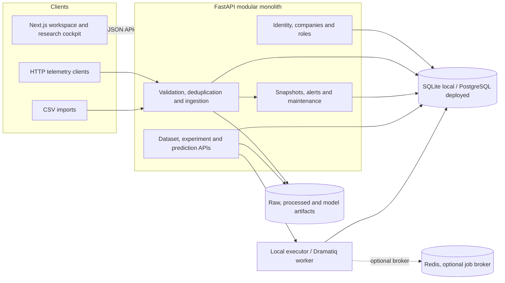

# TelemetryX Industrial

TelemetryX now has an industrial pilot workspace at `/`: company accounts, sites, machinery, timestamped sensor telemetry, connection quality, sustained-threshold alerts and maintenance work orders. The existing C-MAPSS research cockpit is preserved at `/demo`.

**Industrial workflow:** create a company account -> register a site -> register a machine -> define sensors/units/limits -> import CSV or send authenticated HTTP batches -> review condition and connectivity -> acknowledge alerts -> assign work -> record findings and downtime -> verify completion.

Start the API and frontend with the commands below, open http://localhost:3000, and create your first account. There are no preset passwords and no machinery readings are inserted into your company automatically. A password must contain at least 12 characters. See [industrial pilot guide](docs/industrial-pilot.md) for access roles, telemetry contracts, endpoints and current deployment limits.

**Prediction scope:** the industrial workspace currently uses transparent threshold monitoring. Experimental equipment-specific RUL models can be trained from labelled operating histories through the machinery inspector; anomaly and failure-probability models are not enabled. The `/demo` uses synthetic C-MAPSS-shaped fixtures, not official NASA benchmark data; its models do not score industrial machines.

## Architecture flow



## Stack and workflow

- Python 3.12, FastAPI, SQLAlchemy/Alembic, pandas, scikit-learn HistGradientBoosting, SHAP.
- Next.js 15, React 19, TypeScript, Tailwind and Recharts; server data currently uses the typed fetch client and React state.
- SQLite for explicit local development, PostgreSQL for Compose; local background executor or Dramatiq/Redis workers.

Import train/test/test-RUL files -> inspect validation -> prepare/seal a dataset -> split raw training engines -> fit preprocessing on the training partition -> train/evaluate -> score final test cycles -> inspect predictions and explanations.

Training supports `gradient_boosting` and a `naive` median-training-row-capped-RUL baseline. The target cap defaults to 125. The point estimator uses squared-error loss; separate 0.05/0.95 quantile estimators produce nominal 90% prediction intervals. Observed coverage and mean interval width are reported separately for held-out validation cycles and final test cycles. No calibration guarantee is implied.

## Local Windows setup

Run from the repository root, in separate terminals. Install Python 3.12/uv and Node.js/pnpm first.

Backend:
```powershell
Set-Location backend
uv sync --all-groups
$env:DATABASE_URL = "sqlite:///telemetryx_dev.db"
uv run alembic upgrade head
uv run uvicorn app.main:app --host 127.0.0.1 --port 8000 --reload
```

Frontend:
```powershell
Set-Location frontend
corepack pnpm install
corepack pnpm dev
```

Open http://localhost:3000 for industrial operations or http://localhost:3000/demo for research. API docs: http://localhost:8000/docs.

The local executor runs jobs outside request handlers in one background thread. Use only **one API process** in local mode. On API restart, queued jobs resume; interrupted running jobs become failed and can be retried. The dashboard reconnects to its most recent job after a page reload. A multi-step demo interrupted between jobs can be continued using the registry's prediction action.

Database selection is explicit. An unavailable PostgreSQL server does not silently switch to another database. Apply Alembic migrations before starting the API, including for SQLite.

## Upgrading an existing local database

An older build may have created SQLite tables without an Alembic revision. The migration helper verifies the known legacy columns, creates a SQLite backup in `data/backups`, applies the additive migration and verifies existing row counts:

```powershell
Set-Location backend
uv run python -m scripts.migrate_local
```

It refuses an unrecognized legacy schema instead of stamping it blindly. The database backup is ignored by Git; retain it locally for rollback.

For an already Alembic-managed database, run only `uv run alembic upgrade head`. Revision `20261113_0003` adds job input/result columns and preserves existing rows. Existing models remain historical; train a new experiment to obtain the corrected validation preprocessing and interval metrics.

## Docker Compose

```powershell
Copy-Item .env.example .env
# Start dependencies and migrate before starting the API/worker.
docker compose up -d db redis
docker compose run --rm api uv run alembic upgrade head
docker compose up --build -d
```

Compose selects `JOB_BACKEND=redis`. API and worker share raw/processed/model storage. The worker is configured with one process/thread for the MVP. PostgreSQL and Redis readiness checks gate startup.

## Custom imports and immutable versions

In Dataset Explorer, select **Create a new dataset version**, choose `train`, and upload its text file. Uncheck the new-version option to add `test`, then `test_rul` to that draft. RUL labels require test telemetry first and align to consecutive test unit IDs starting at 1. Inspect each file's validation report and checksum before selecting **Prepare, train and predict**.

A validated role cannot be replaced within a version. Identical content is reused without changing engine IDs. Preparing seals the version against further imports; changed files require a fresh version. Original bytes are stored under content hashes. Source and experiment feature CSV/JSON snapshots are stored under distinct feature-set IDs with checksums. An experiment's manifest records its exact train/validation engine split, scaler statistics, selected sensors, RUL cap and source checksum.

## API

All paths are under `/api/v1`. Long operations return **202** with a job ID, status, attempt count, error and result. Poll `/jobs/{id}` for completion. Validation failure is a failed job with `result.report.errors`, not successful ingestion.

| Method | Path | Behavior |
|---|---|---|
| GET | `/health/live`, `/health/ready` | Liveness and database connectivity |
| POST | `/datasets` | Create a fresh FD001 draft |
| GET | `/datasets`, `/datasets/{id}` | Dataset metadata and per-file reports/checksums |
| POST | `/datasets/imports` | Multipart upload (`file`, `dataset_id`, `file_role`) and import job |
| POST | `/datasets/sample` | Synthetic fixture import/preparation job |
| POST | `/datasets/{id}/prepare` | Seal source and persist a feature snapshot |
| GET | `/datasets/{id}/engines` | Optional `role`, `model_version_id` filters |
| GET | `/engines/{id}` | Inspection, optional `model_version_id` |
| GET | `/engines/{id}/cycles` | `start_cycle`, `end_cycle`, `offset`, `limit` (max 10000) |
| GET/POST | `/experiments` | List experiments / enqueue training |
| GET | `/experiments/{id}` | Split/config and registered model |
| GET | `/models`, `/models/{id}` | Registry and artifact manifest |
| POST | `/models/{id}/predictions` | Prediction job (`dataset_id`, `role=train/test`) |
| GET | `/predictions`, `/predictions/{id}` | Stored prediction evidence and recommendations |
| GET | `/evaluations` | Distinct validation/test reports, including interval coverage |
| GET | `/dashboard/summary` | One dataset/model scope (`dataset_id`, `model_version_id`); test engines only |
| GET | `/jobs/{id}` | Poll a job |
| POST | `/jobs/{id}/retry` | Replay a failed job |
| POST | `/jobs/{id}/cancel` | Cancel a queued job |

Sample/import/training requests accept `Idempotency-Key`. Reusing a key with different inputs is rejected. Transient storage/database failures retry with bounded backoff up to `JOB_MAX_ATTEMPTS`; validation errors do not automatically retry. Results and inputs persist in the database. Jobs are not distributed exactly-once transactions: a crash after a service commit can leave completed outputs without a recorded job result. Inspect outputs before manual replay.

After an abrupt Redis worker termination, stop all workers, run `uv run python -m app.workers.recover`, restart workers, and retry the interrupted job through the API. This recovery operation must not run while workers are executing. Queued Redis deliveries remain broker-managed.

## Configuration

Settings are read from environment variables or `backend/.env` relative to the backend working directory. Compose reads the root `.env`. `RAW_STORAGE_PATH`, `PROCESSED_STORAGE_PATH`, `MODEL_STORAGE_PATH`, `MAX_UPLOAD_SIZE_MB`, `JOB_BACKEND`, `JOB_MAX_ATTEMPTS`, `DATABASE_URL`, `REDIS_URL` and CORS origins are applied. Local storage defaults to repository data/model folders; Compose uses mounted `/data` and `/models` paths. Upload filenames are display metadata and never choose filesystem paths.

## Verification

```powershell
Set-Location backend
uv run pytest
uv run ruff check .
uv run ruff format --check .
uv run mypy app
```

```powershell
Set-Location frontend
corepack pnpm test
corepack pnpm typecheck
corepack pnpm build
```

Backend tests use temporary databases/storage and never ingest into your development database or overwrite your model files. Regression coverage includes holdout-only preprocessing, immutable byte-preserving imports, artifact compatibility, jobs/retries, migration preservation, interval metrics and dataset/model scoping. Frontend tests cover jobs, multipart imports, demo orchestration and error presentation.

SSO/MFA, email verification and account recovery, protocol gateways, equipment-specific anomaly/failure-probability models, hosted CI automation and production deployment hardening remain future work. See [architecture](docs/architecture.md), [data dictionary](docs/data-dictionary.md) and [data provenance](docs/cmapss-provenance.md).

## Equipment-specific remaining-life models

In **Machinery**, select equipment and open **Remaining life. With evidence.**
An admin or engineer can download a training CSV template and upload labeled history.
The CSV uses `run_id,remaining_hours,<registered_sensor_key>,...` with 100–10,000
snapshots from at least five independent failure runs, up to 30 sensors and 2 MB.
One run identifies a single asset life between repairs. Use known remaining-time
labels in hours and the registered sensor units; ordinary unlabeled telemetry
cannot train an RUL model. Train only on representative equipment and operating
conditions. No NASA or generated sample data is automatically assigned to equipment.

Training creates an immutable machine/company-specific version. The 80/20 split
holds out entire runs. The page reports validation MAE, RMSE, median-baseline MAE
and observed coverage of the nominal 90% quantile interval. Models remain experimental;
this split alone does not establish suitability for maintenance decisions.
Training is synchronous and bounded by the upload limits.

An admin, manager or engineer can request an estimate from fresh, aligned readings.
Inference requires every training sensor with its original unit, readings no more
than three sampling intervals old, alignment within the smallest sampling interval,
and values within the training partition's observed ranges. Missing or incompatible
inputs block inference. Viewer and technician roles can inspect results.

Each estimate retains its model version, source checksum, input values/timestamps,
validation metrics and sensitivity evidence. Sensitivity replaces one sensor value
with its training median; it is not causal attribution. The inspector plots the
latest 50 estimates and shows whether the latest model's estimate matches current
sensor readings. The fleet table labels the last estimate with its observation time.
Threshold health and alerts continue to describe observed limits independently;
RUL estimates do not automatically open alerts or maintenance orders.

API (under `/api/v1/industrial/companies/{company_id}/machines/{machine_id}`):
- `GET /predictive`: model, readiness and prediction history.
- `POST /predictive/train`: multipart `file` containing labeled CSV.
- `POST /predictive/predict`: estimate from current registered sensor readings.

Run `alembic upgrade head` before starting the updated backend.

## Testing evaluation report

The evaluation report is in `docs/testing-evaluation-report.md` and `output/pdf/TelemetryX_Software_Testing_and_Evaluation_Report.pdf`. Recorded results are under `output/testing/evidence`. Browser tests use disposable storage and a separate production build on ports 3001/8001.

Use Node.js 22.12 or newer for the test tooling. From `frontend`, install browser binaries with `corepack pnpm exec playwright install chromium firefox`, then run `corepack pnpm test:e2e --repeat-each=2`. The current server launch paths target Windows. These tests do not use your development database.
