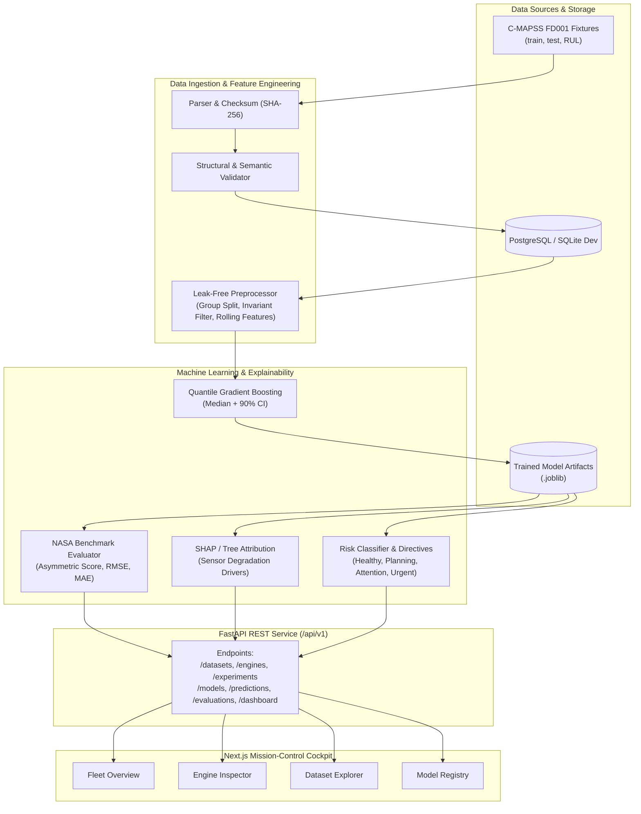

# TelemetryX — NASA C-MAPSS Turbofan Predictive Maintenance & RUL Cockpit

[](https://www.python.org/)
[](https://fastapi.tiangolo.com)
[](https://nextjs.org/)
[](https://www.typescriptlang.org/)
[](https://tailwindcss.com/)
[]()

TelemetryX is a predictive maintenance platform and Remaining Useful Life (RUL) estimation mission-control cockpit powered by NASA C-MAPSS turbofan engine simulation data (FD001). It pairs a rigorous, leak-free machine learning backend (FastAPI, Scikit-learn, SHAP, SQLAlchemy) with an aerospace mission-control frontend (Next.js 15, Recharts, Tailwind CSS).

---

## 🌟 Key Capabilities

### 1. Ingestion & Validation Pipeline
- **NASA C-MAPSS Whitespace Streaming Parser**: Ingests raw space-delimited telemetry rows (`train_FD001.txt`, `test_FD001.txt`, `RUL_FD001.txt`) with SHA-256 cryptographic provenance.
- **Two-Tier Validation**:
  - *Structural Validation*: Verifies exactly 26 columns per cycle record and absence of NaN/infinite values.
  - *Semantic Validation*: Enforces strictly monotonic cycle increments, positive physical units, and test-engine-to-ground-truth unit alignment.
- **Idempotent Ingestion**: Handles repeat imports and checksum re-indexing cleanly.

### 2. Leak-Free Preprocessing Engine
- **Zero Sequence Leakage**: Preprocessor parameters, standard scalers, and invariant sensor masks are fitted strictly on training engine units (`train_FD001.txt`). Test engines and ground-truth RUL files are never leaked into the training pipeline.
- **Sensor Variance Filtering**: Identifies and drops invariant sensors with near-zero variance in FD001 (`s1, s5, s10, s16, s18, s19`), retaining the 14 degradation-informative sensor channels.
- **Feature Engineering**: Calculates rolling statistics (mean, standard deviation, lag delta, linear trend slope) over 5- and 15-cycle operational windows without memory fragmentation.
- **Target RUL Capping**: Applies standard aerospace piece-wise linear degradation target capping ($RUL_{cap} = 125$ cycles), accounting for initial healthy operating states.

### 3. Machine Learning & NASA Scoring
- **Quantile Gradient Boosting RUL Regressor**: Computes point predictions along with 90% confidence prediction intervals ($\alpha = 0.05$ lower bound, $\alpha = 0.95$ upper bound).
- **Naive Baseline Model**: Computes median training engine lifespan for empirical benchmark reference.
- **Official NASA Benchmark Scoring**:
  $$S = \sum_{i=1}^{N} s_i, \quad s_i = \begin{cases} e^{-d_i / 13} - 1 & \text{for } d_i < 0 \text{ (early / underestimation)} \\ e^{d_i / 10} - 1 & \text{for } d_i \ge 0 \text{ (late / overestimation)} \end{cases}$$
  Penalizes dangerous late predictions exponentially more severely than conservative early predictions.
- **Evaluation Suite**: Computes NASA Score, RMSE, MAE, $R^2$, per-unit residuals, and true-RUL band breakdowns ($RUL \le 20, 21\text{--}50, >50$).

### 4. Explainability & Maintenance Directives
- **SHAP / Tree Feature Attribution**: Surfaces top positive (degradation accelerants) and negative (stabilizing) sensor contributions per cycle.
- **4-Tier Operational Risk Classification**:
  - 🟢 **Healthy** ($RUL > 30$): Standard maintenance interval.
  - 🔵 **Planning** ($15 \le RUL \le 30$): Schedule servicing in upcoming hangar rotation.
  - 🟡 **Attention** ($5 \le RUL < 15$): Priority maintenance inspection scheduled.
  - 🔴 **Urgent** ($RUL < 5$): Immediate grounding and teardown inspection required.

### 5. Next.js Aerospace Cockpit
- **Fleet Overview**: Top KPI cards (Active Fleet Units, Mean Fleet RUL, Attention Count, Urgent Count), multi-segment risk distribution bar, critical alert list, and research-backed maintenance directives.
- **Engine Inspector**: Operational cycle counter, RUL gauge with 90% confidence interval badge, SHAP feature waterfall chart, and multi-sensor interactive time-series telemetry charts (Recharts).
- **Dataset Explorer**: Lineage audit, SHA-256 checksums, validation report summary, and interactive engine directory.
- **Model Registry**: Benchmark score cards (NASA Score vs RMSE/MAE), model hyperparameters, test batch triggers, and actual vs predicted RUL scatter plot.
- **One-Click Demo Setup**: Automatic loading, training, prediction, and dashboard hydration directly from the cockpit interface.

---

## 🏗️ Architecture



---

## 🚀 Quick Start Guide

### Prerequisites
- **Python 3.12** (managed with `uv`)
- **Node.js 22 LTS** + `pnpm` (or `corepack pnpm`)
- *(Optional)* **Docker & Docker Compose**

---

### Option A: Running Locally (Fastest, Zero Docker Dependency)

TelemetryX includes automatic SQLite fallback (`sqlite:///telemetryx_dev.db`) when PostgreSQL is not running locally.

#### 1. Start the Backend API
From the workspace root:
```powershell
Set-Location backend
uv sync --all-groups
.\.venv\Scripts\python.exe -m uvicorn app.main:app --host 0.0.0.0 --port 8000 --reload
```
The FastAPI backend is now running at `http://localhost:8000`.
- Interactive Swagger docs: [http://localhost:8000/docs](http://localhost:8000/docs)
- Liveness check: [http://localhost:8000/api/v1/health/live](http://localhost:8000/api/v1/health/live)

#### 2. Start the Frontend Cockpit
In a separate terminal window:
```powershell
Set-Location frontend
corepack.cmd pnpm install
corepack.cmd pnpm dev
```
Open [http://localhost:3000](http://localhost:3000) in your browser.

#### 3. One-Click Demo
Click the glowing **"Quick Demo Setup"** button in the top navigation bar. In seconds, the application will:
1. Ingest NASA C-MAPSS FD001 training and test datasets.
2. Run leak-free structural and semantic validation.
3. Train the Quantile Gradient Boosting RUL model with 90% confidence intervals.
4. Generate test batch predictions, SHAP attribution, and evaluation benchmark scores.
5. Populate all four cockpit tabs with live telemetry and charts.

---

### Option B: Running with Docker Compose

```powershell
Copy-Item .env.example .env
docker compose up --build -d
docker compose exec api uv run alembic upgrade head
```

- Frontend: [http://localhost:3000](http://localhost:3000)
- Backend Docs: [http://localhost:8000/docs](http://localhost:8000/docs)

---

## 🧪 Verification & Test Commands

### Backend Suite (Unit & End-to-End Integration)
```powershell
Set-Location backend
.\.venv\Scripts\python.exe -m pytest -v
.\.venv\Scripts\python.exe -m ruff check .
.\.venv\Scripts\python.exe -m ruff format --check .
.\.venv\Scripts\python.exe -m mypy app
```
*Current Status: 18 passed, Ruff 0 errors, Mypy 0 issues across 37 files.*

### Frontend Suite (Vitest & Production Build)
```powershell
Set-Location frontend
corepack.cmd pnpm test
corepack.cmd pnpm typecheck
corepack.cmd pnpm build
```
*Current Status: 4 passed, TypeScript 0 errors, Next.js optimized production build succeeds.*

---

## 📡 REST API Reference (`/api/v1`)

| Method | Endpoint | Description |
| :--- | :--- | :--- |
| `GET` | `/health/live` | Liveness probe |
| `GET` | `/health/ready` | Database readiness check |
| `POST` | `/datasets/upload` | Upload & ingest raw C-MAPSS text files |
| `GET` | `/datasets` | List all registered dataset versions |
| `GET` | `/datasets/{id}` | Retrieve dataset version metadata & file checksums |
| `GET` | `/datasets/{id}/validation-report` | Retrieve structural and semantic validation results |
| `GET` | `/datasets/{id}/engines` | List all engine units in a dataset |
| `GET` | `/engines/{id}` | Get engine details, current cycle, and latest prediction |
| `GET` | `/engines/{id}/cycles` | Paginated cycle telemetry (26 variables) |
| `POST` | `/experiments` | Create and execute model training experiments |
| `GET` | `/experiments` | List experiments and hyperparameter specs |
| `GET` | `/models` | Model registry with status and metadata |
| `GET` | `/models/{id}` | Detailed model artifact metadata |
| `POST` | `/predictions/run` | Execute batch RUL predictions on an engine split |
| `GET` | `/predictions/engine/{id}` | Latest RUL prediction, confidence interval, and SHAP attribution |
| `GET` | `/evaluations` | List evaluation benchmark runs |
| `GET` | `/evaluations/{id}` | NASA benchmark score, RMSE, MAE, R², and residual distributions |
| `GET` | `/dashboard/fleet-summary` | High-level fleet KPIs, risk distribution, and urgent alerts |

---

## 📖 Dataset Provenance & Attribution

- **Dataset**: NASA C-MAPSS (Commercial Modular Aero-Propulsion System Simulation)
- **Sub-dataset**: FD001 (Single operating condition: Sea Level; Single fault mode: High-Pressure Compressor degradation)
- **Citation**: A. Saxena and K. Goebel (2008). *"Turbofan Engine Degradation Simulation Data Set"*, NASA Ames Prognostics Data Repository.
- Detailed variable descriptions and physical units: [docs/data-dictionary.md](docs/data-dictionary.md)
- Complete dataset lineage and checksums: [docs/cmapss-provenance.md](docs/cmapss-provenance.md)
- Architecture and leakage prevention guarantees: [docs/architecture.md](docs/architecture.md)

---

## ⚖️ License
MIT License. Built for predictive maintenance research and mission-critical engineering excellence.
